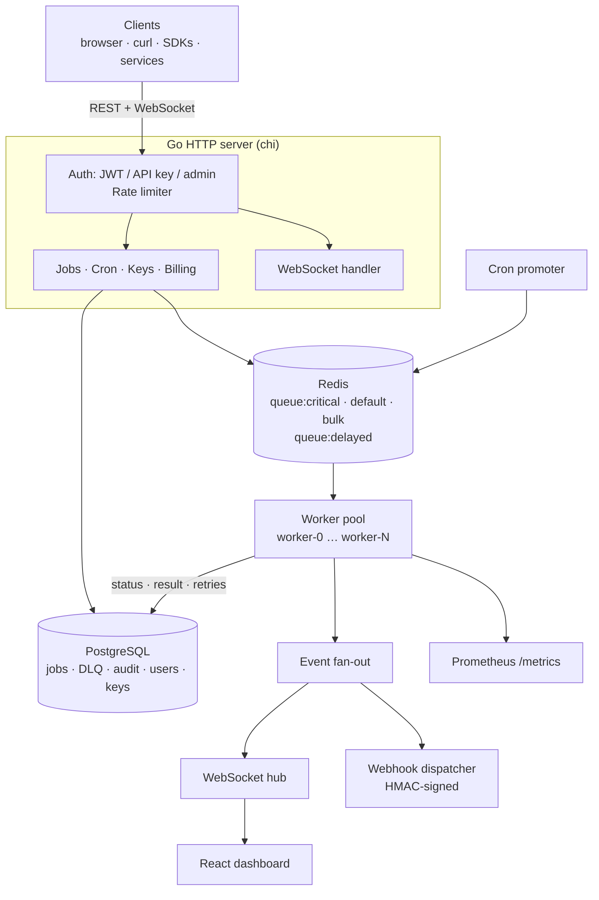

# Queuely: self-hosted distributed job queue in Go, Redis and PostgreSQL

[](https://github.com/dhananjay6561/jobqueue/actions/workflows/ci.yml)
[](https://github.com/dhananjay6561/jobqueue/actions/workflows/docker.yml)


**Queuely is a self-hosted background job queue and task scheduler written in Go.** Your app enqueues work over a REST API, a pool of workers runs it concurrently with retries and exponential backoff, and a real-time React dashboard shows every job, worker and failure as it happens. It ships with cron scheduling, a dead-letter queue, HMAC-signed webhooks, Prometheus metrics, multi-tenant API keys, and client SDKs for Go, Node.js and Python.

PostgreSQL is the source of truth, Redis is the broker, and the whole stack starts with one command.

**New to job queues?** Read the [beginner guide](GUIDE.md) first.

### At a glance

| | |
| --- | --- |
| What it is | A distributed background job processing system with a REST API and live dashboard |
| Language | Go 1.26 backend, React 19 + TypeScript dashboard |
| Storage | PostgreSQL (jobs, audit trail, DLQ, users, keys) and Redis (priority queues) |
| Interfaces | REST API, WebSocket event stream, [OpenAPI 3.1 spec](openapi.yaml), Prometheus `/metrics` |
| SDKs | Go, Node.js (ESM + CJS + TypeScript types), Python (sync + async) |
| Run it | `./run.sh` (Docker Compose) or one-click on Render with [`render.yaml`](render.yaml) |
| Image | Multi-stage, distroless, non-root, published to GHCR |

## Why Queuely

When a request needs to do something slow, like sending an email, resizing an image or building a report, the user shouldn't wait for it. Queuely takes that work off the request path and runs it in the background, reliably:

- **Nothing gets lost.** Every job is written to PostgreSQL before it hits Redis, so the database always knows the real state of every job.
- **Failures are handled for you.** Retries back off exponentially, and jobs that run out of attempts land in a dead-letter queue you can requeue with one click.
- **Urgent work goes first.** Three priority-ordered queues (`critical`, `default`, `bulk`) plus a 1 to 10 priority on every job.
- **You can see everything.** A WebSocket-powered dashboard shows live jobs, worker heartbeats, throughput and the DLQ, with no polling.
- **It's ready for more than one team.** Each API key only sees its own jobs, with per-key rate limits and monthly usage metering.

```
Your app                    Queuely
────────────────            ──────────────────────────────────
POST /api/v1/jobs ────────► Saved to PostgreSQL
                            Pushed into a Redis priority queue
                ◄────────── Returns the job ID instantly

                            A worker picks up the job
                            Runs your handler
                            Retries on failure (exponential backoff)
                            Moves to the DLQ after max attempts
```

## Features

**Jobs and queues**
- Enqueue single jobs or batches of up to 500 in one transaction
- Get, list, cancel and retry jobs, and store each job's result
- Three priority-ordered queues: `critical`, `default`, `bulk`
- Per-job priority (1 to 10) and per-job `max_attempts`
- Arbitrary `key:value` tags, filterable on list endpoints
- Offset pagination, plus cursor pagination that stays stable while jobs are being inserted

**Scheduling and reliability**
- `scheduled_at` for one-off future jobs
- Recurring jobs from standard 5-field cron expressions, which you can pause, edit or delete
- Exponential backoff retries with a configurable base delay and cap
- Dead-letter queue that keeps failed jobs, with one-click requeue
- Per-job TTL, a bulk purge endpoint and an hourly cleanup sweep
- Worker heartbeats and graceful shutdown that drains in-flight jobs

**Auth and multi-tenancy**
- Register and log in with JWT sessions for the dashboard
- Database-backed API keys with Free, Pro and Business tiers
- Each API key sees only its own jobs; an `ADMIN_KEY` sees everything
- Per-key token-bucket rate limiting with `X-RateLimit-*` headers
- Monthly job metering that returns `429` once a key hits its limit

**Observability and integrations**
- Real-time WebSocket stream of job, worker and stats events
- React dashboard for jobs, workers, the DLQ, cron schedules and live events
- Prometheus `/metrics` with counters, gauges and duration histograms
- Webhooks on job lifecycle events, signed with HMAC-SHA256
- Health endpoint that checks PostgreSQL and Redis

## Architecture



## Quick start

**You need:** Docker with Docker Compose v2.

```bash
git clone https://github.com/dhananjay6561/jobqueue
cd jobqueue
./run.sh
```

The script builds the image, starts PostgreSQL, Redis and the app, and waits until the health check passes. Database migrations run on startup.

Open **http://localhost:8080** and sign in with the demo account (`demo@jobqueue.dev` / `demo1234`) or create your own. A database UI (Adminer) is also available at http://localhost:8081.

Get an API key and enqueue your first job:

```bash
# Register: the response includes a free-tier API key (shown once)
curl -X POST http://localhost:8080/auth/register \
  -H 'Content-Type: application/json' \
  -d '{"email": "you@example.com", "password": "yourpassword"}'

# Enqueue a job with that key
curl -X POST http://localhost:8080/api/v1/jobs \
  -H 'Content-Type: application/json' \
  -H 'X-API-Key: <your-api-key>' \
  -d '{"type": "send_email", "payload": {"to": "user@example.com"}}'
```

Watch it move from `pending` to `running` to `completed` on the dashboard.

There's also a small [example app](example-app/main.go) that enqueues a `send_email` job from its own `/register` endpoint and returns instantly:

```bash
JOBQUEUE_API_KEY=<your-api-key> go run example-app/main.go
curl "http://localhost:9091/register?email=you@example.com&name=Alice"
```

## Writing your own job handler

Workers run inside the Go server. A handler is a function registered for a job `type`:

```go
workerPool.Register("send_email", func(ctx context.Context, job *queue.Job) (any, error) {
    // read job.Payload, do the work
    // return a result to store it, or an error to trigger a retry
    return map[string]any{"sent": true}, nil
})
```

Out of the box, [`cmd/server/main.go`](cmd/server/main.go) registers simulated handlers for the job types the dashboard offers (`send_email`, `resize_image`, `generate_report`, `process_payment` and more). Each one sleeps for 500 ms and returns a result, so you can watch the full lifecycle. Replace them with real work for your app.

## API reference

The full contract is in [`openapi.yaml`](openapi.yaml). The essentials are below.

### Authentication

Every `/api/v1/*` endpoint needs one of:

- **JWT session** (dashboard users): log in at `/auth/login` and send `Authorization: Bearer <token>`.
- **API key** (programmatic access): send `X-API-Key: <your-key>` on every request.

```bash
curl -H 'X-API-Key: <key>' http://localhost:8080/api/v1/jobs
```

### Response envelope

Every endpoint returns the same shape:

```json
{ "data": <result or null>, "error": <message or null>, "meta": { "request_id": "..." } }
```

List endpoints add pagination to `meta`:

```json
"meta": { "total_count": 42, "limit": 20, "offset": 0, "has_more": true }
```

### Jobs

```bash
# Enqueue a job
curl -X POST http://localhost:8080/api/v1/jobs \
  -H 'Content-Type: application/json' \
  -H 'X-API-Key: <key>' \
  -d '{
    "type": "send_email",
    "payload": {"to": "user@example.com"},
    "priority": 8,
    "queue_name": "default",
    "max_attempts": 3,
    "ttl_seconds": 86400,
    "tags": {"env": "prod", "user_id": "42"}
  }'

# Batch enqueue (up to 500, single transaction)
curl -X POST http://localhost:8080/api/v1/jobs/batch \
  -H 'Content-Type: application/json' \
  -H 'X-API-Key: <key>' \
  -d '[
    {"type":"resize_image","payload":{"url":"..."}},
    {"type":"send_email","payload":{"to":"..."}}
  ]'

# Schedule for the future
curl -X POST http://localhost:8080/api/v1/jobs \
  -H 'Content-Type: application/json' \
  -H 'X-API-Key: <key>' \
  -d '{"type":"send_notification","payload":{"user_id":42},"scheduled_at":"2026-12-01T09:00:00Z"}'

# List jobs (offset pagination)
curl -H 'X-API-Key: <key>' \
  "http://localhost:8080/api/v1/jobs?status=failed&limit=20&offset=0"

# List jobs (cursor pagination, stable across concurrent inserts)
curl -H 'X-API-Key: <key>' "http://localhost:8080/api/v1/jobs/cursor?limit=20"
curl -H 'X-API-Key: <key>' "http://localhost:8080/api/v1/jobs/cursor?cursor=<next_cursor>"

# Filter by tags
curl -H 'X-API-Key: <key>' "http://localhost:8080/api/v1/jobs?tags=env:prod,user_id:42"

# Get a job, or its stored result
curl -H 'X-API-Key: <key>' http://localhost:8080/api/v1/jobs/<id>
curl -H 'X-API-Key: <key>' http://localhost:8080/api/v1/jobs/<id>/result

# Cancel a pending job / retry a failed one
curl -X DELETE -H 'X-API-Key: <key>' http://localhost:8080/api/v1/jobs/<id>
curl -X POST   -H 'X-API-Key: <key>' http://localhost:8080/api/v1/jobs/<id>/retry

# Bulk-delete finished jobs older than a timestamp
curl -X DELETE -H 'X-API-Key: <key>' \
  "http://localhost:8080/api/v1/jobs?before=2026-01-01T00:00:00Z"
```

**Job fields**

| Field | Type | Required | Description |
|---|---|---|---|
| `type` | string | yes | The handler this job runs on |
| `payload` | object | no | Any JSON, passed to the handler |
| `priority` | int (1 to 10) | no | Higher runs first. Default: 5 |
| `queue_name` | string | no | `default`, `critical` or `bulk`. Default: `default` |
| `max_attempts` | int | no | Retry ceiling. Default: 5 |
| `scheduled_at` | RFC 3339 | no | Run at a future time |
| `ttl_seconds` | int | no | Delete the job N seconds after it finishes |
| `tags` | object | no | `{"key": "value"}` metadata for filtering |

### Dead-letter queue

```bash
# List failed jobs (add include_requeued=true to see requeued entries too)
curl -H 'X-API-Key: <key>' "http://localhost:8080/api/v1/dlq?limit=20"

# Requeue a dead job (creates a fresh job linked back to this entry)
curl -X POST -H 'X-API-Key: <key>' http://localhost:8080/api/v1/dlq/<id>/requeue
```

### Cron schedules

```bash
# Create a recurring schedule
curl -X POST http://localhost:8080/api/v1/cron \
  -H 'Content-Type: application/json' \
  -H 'X-API-Key: <key>' \
  -d '{
    "name": "daily-cleanup",
    "job_type": "cleanup_storage",
    "cron_expression": "0 2 * * *",
    "payload": {"target": "tmp"},
    "queue_name": "bulk",
    "priority": 3
  }'

# Pause it, or change when it runs
curl -X PATCH http://localhost:8080/api/v1/cron/<id> \
  -H 'Content-Type: application/json' -H 'X-API-Key: <key>' \
  -d '{"enabled": false}'
curl -X PATCH http://localhost:8080/api/v1/cron/<id> \
  -H 'Content-Type: application/json' -H 'X-API-Key: <key>' \
  -d '{"cron_expression": "*/30 * * * *"}'

# List / delete
curl -H 'X-API-Key: <key>' http://localhost:8080/api/v1/cron
curl -X DELETE -H 'X-API-Key: <key>' http://localhost:8080/api/v1/cron/<id>
```

| Expression | Meaning |
|---|---|
| `* * * * *` | Every minute |
| `*/15 * * * *` | Every 15 minutes |
| `0 * * * *` | Every hour, on the hour |
| `0 9 * * *` | Daily at 09:00 |
| `0 9 * * 1` | Every Monday at 09:00 |
| `0 2 1 * *` | 02:00 on the 1st of every month |

### Webhooks

```bash
# Register an endpoint
curl -X POST http://localhost:8080/api/v1/webhooks \
  -H 'Content-Type: application/json' \
  -H 'X-API-Key: <key>' \
  -d '{
    "url": "https://yourapp.com/hooks/jobqueue",
    "secret": "your-signing-secret",
    "events": ["job.completed", "job.failed", "job.dead"]
  }'

# List / delete
curl -H 'X-API-Key: <key>' http://localhost:8080/api/v1/webhooks
curl -X DELETE -H 'X-API-Key: <key>' http://localhost:8080/api/v1/webhooks/<id>
```

Events: `job.enqueued` `job.started` `job.completed` `job.failed` `job.dead`

Verify the signature in your receiver:

```js
// Node.js
const sig = crypto.createHmac('sha256', 'your-signing-secret')
  .update(rawBody).digest('hex')
if (`sha256=${sig}` !== req.headers['x-webhook-signature']) {
  return res.status(401).send('Bad signature')
}
```

### Stats, workers, health and metrics

```bash
curl -H 'X-API-Key: <key>' http://localhost:8080/api/v1/stats    # job counts by status
curl -H 'X-API-Key: <key>' http://localhost:8080/api/v1/workers  # worker pool status
curl -H 'X-API-Key: <key>' http://localhost:8080/api/v1/usage    # monthly usage vs limit
curl http://localhost:8080/health                                 # PostgreSQL + Redis health
curl http://localhost:8080/metrics                                # Prometheus text format
```

### WebSocket events

Connect to `ws://localhost:8080/ws` for a live event stream:

```bash
websocat ws://localhost:8080/ws
```

| Event | Sent when |
|---|---|
| `job.enqueued` | A new job is accepted |
| `job.started` | A worker claims a job |
| `job.completed` | The handler returns successfully |
| `job.failed` | The handler errors and the job will retry |
| `job.dead` | All retries are used up and the job moves to the DLQ |
| `worker.heartbeat` | Every 10 s per worker |
| `stats.update` | An aggregate snapshot every 5 s |

## Client SDKs

The SDKs live in [`sdk/`](sdk) and aren't published to package registries yet, so install them from your clone.

### Go

```bash
go mod edit -replace github.com/dhananjay6561/jobqueue-go=../jobqueue/sdk/go
go get github.com/dhananjay6561/jobqueue-go
```

```go
import jobqueue "github.com/dhananjay6561/jobqueue-go"

client := jobqueue.New("http://localhost:8080", jobqueue.WithAPIKey("<key>"))

job, err := client.Enqueue(ctx, jobqueue.EnqueueRequest{
    Type:     "send_email",
    Payload:  map[string]any{"to": "user@example.com"},
    Priority: 8,
})

// Poll until it finishes, then read the result
for job.Status != "completed" && job.Status != "dead" {
    time.Sleep(500 * time.Millisecond)
    job, _ = client.GetJob(ctx, job.ID.String())
}
result, _ := client.GetJobResult(ctx, job.ID.String())
```

### Node.js

```bash
npm install ../jobqueue/sdk/node
```

```js
import { JobQueueClient } from '@jobqueue/client'

const jq = new JobQueueClient('http://localhost:8080', { apiKey: '<key>' })

const job = await jq.enqueue({ type: 'send_email', payload: { to: 'user@example.com' } })

const jobs = await jq.enqueueBatch([
  { type: 'resize_image', payload: { url: '...' } },
  { type: 'send_email',   payload: { to: '...'  } },
])

const failed = await jq.listJobs({ status: 'failed', limit: 20 })
```

### Python

```bash
pip install ../jobqueue/sdk/python
```

```python
from jobqueue_client import JobQueueClient, AsyncJobQueueClient

# Sync
with JobQueueClient("http://localhost:8080", api_key="<key>") as jq:
    job = jq.enqueue(type="send_email", payload={"to": "user@example.com"})
    batch = jq.enqueue_batch([
        {"type": "resize_image", "payload": {"url": "..."}},
        {"type": "send_email",   "payload": {"to": "..."}},
    ])
    page = jq.list_jobs_cursor(limit=50)

# Async
async with AsyncJobQueueClient("http://localhost:8080", api_key="<key>") as jq:
    job = await jq.enqueue(type="generate_report", payload={"id": 1})
```

## How it works

### Priority ordering

Jobs sit in Redis sorted sets, and the score encodes both priority and schedule time:

```
score = -(priority × 1e15) + scheduledAt.UnixNano
```

The `1e15` multiplier is larger than about 285 years of nanosecond timestamps, so a priority-10 job always runs before a priority-1 job no matter when it was scheduled. Within the same priority, the earlier `scheduled_at` wins.

### Retries and the dead-letter queue

```
Handler returns an error
        │
        ▼
attempts < max_attempts?
    ├── YES → status = failed, re-enqueued after a backoff:
    │          delay = base_delay × 2^(attempt-1), capped at max_delay
    │          e.g. 5s → 10s → 20s → 40s → 80s → ...
    │
    └── NO  → status = dead → row in dead_letter_jobs
                               WebSocket broadcasts job.dead
```

DLQ entries are kept until you remove them or their `expires_at` passes. Requeueing through `POST /api/v1/dlq/:id/requeue` creates a fresh job with reset counters and marks the DLQ entry as `requeued`.

## Plans

| Tier | Jobs per month | Price |
|---|---|---|
| Free | 1,000 | $0 |
| Pro | 100,000 | $29/mo (coming soon) |
| Business | Unlimited | $99/mo (coming soon) |

Registering gives you a free-tier API key. The Stripe Checkout integration for upgrades is in the backend (`STRIPE_*` variables below); the dashboard shows Pro and Business as coming soon.

## Configuration

All settings come from environment variables. See [`.env.example`](.env.example) for a starting point.

| Variable | Default | Description |
|---|---|---|
| `JWT_SECRET` | `change-me-in-production` | Signs user session tokens. **Set this in production** |
| `BASE_URL` | `http://localhost:8080` | Public URL, used for Stripe redirects |
| `API_KEY` | `""` | Static API key (leave empty to use database-backed keys) |
| `ADMIN_KEY` | `""` | Operator key that sees every tenant's jobs |
| `SERVER_HOST` | `0.0.0.0` | HTTP bind interface |
| `SERVER_PORT` | `8080` | HTTP port (`PORT` also works on PaaS hosts) |
| `SERVER_READ_TIMEOUT` | `15s` | |
| `SERVER_WRITE_TIMEOUT` | `30s` | |
| `SERVER_IDLE_TIMEOUT` | `120s` | |
| `RATE_LIMIT_RPS` | `100` | Requests per second per key (or per IP) |
| `RATE_LIMIT_BURST` | `20` | Token bucket burst size |
| `DATABASE_DSN` | **required** | PostgreSQL connection string |
| `DB_MAX_CONNS` | `20` | Max pool connections |
| `DB_MIN_CONNS` | `2` | Min idle connections |
| `DB_MAX_CONN_LIFETIME` | `30m` | |
| `DB_MAX_CONN_IDLE_TIME` | `5m` | |
| `REDIS_ADDR` | `localhost:6379` | Redis address |
| `REDIS_PASSWORD` | `""` | Redis password |
| `REDIS_DB` | `0` | Redis database index |
| `REDIS_TLS` | `false` | `true` for TLS-only Redis such as Upstash |
| `REDIS_DIAL_TIMEOUT` | `5s` | |
| `REDIS_READ_TIMEOUT` | `3s` | |
| `REDIS_WRITE_TIMEOUT` | `3s` | |
| `WORKER_COUNT` | `5` | Concurrent worker goroutines |
| `WORKER_HEARTBEAT_INTERVAL` | `10s` | |
| `WORKER_POLL_INTERVAL` | `1s` | Poll interval when the queue is empty |
| `WORKER_SHUTDOWN_TIMEOUT` | `30s` | Graceful drain deadline |
| `RETRY_BASE_DELAY` | `5s` | First backoff delay |
| `RETRY_MAX_DELAY` | `1h` | Backoff cap |
| `RETRY_DEFAULT_MAX_ATTEMPTS` | `5` | Default retry ceiling |
| `STRIPE_SECRET_KEY` | `""` | Stripe API key (billing is optional) |
| `STRIPE_WEBHOOK_SECRET` | `""` | Stripe webhook signing secret |
| `STRIPE_PRO_PRICE_ID` | `""` | Stripe Price ID for Pro |
| `STRIPE_BUSINESS_PRICE_ID` | `""` | Stripe Price ID for Business |

## Deployment

**Docker image.** Every push to `master` and every `v*` tag publishes a multi-stage, distroless, non-root image to GitHub Container Registry:

```bash
docker pull ghcr.io/dhananjay6561/jobqueue:master
```

**Render.** [`render.yaml`](render.yaml) is a blueprint for the web service plus a managed PostgreSQL database. Point it at an external Redis (set `REDIS_TLS=true` for Upstash).

## Local development

```bash
docker compose up postgres redis -d   # just the infrastructure

make run-race     # run the server with the race detector
make test-race    # tests with the race detector
make test-cover   # coverage report
make lint         # golangci-lint
make help         # every target
```

## Project structure

```
.
├── cmd/server/            # Entry point: wires config, stores, broker, workers and HTTP
├── internal/
│   ├── api/
│   │   ├── handler/       # HTTP handlers: jobs, cron, auth, billing, keys, workers, WS
│   │   ├── middleware/    # Auth (JWT + API key), CORS, logging, rate limiting
│   │   ├── metrics.go     # Prometheus handler
│   │   └── router.go      # Route definitions
│   ├── config/            # Environment variable parsing
│   ├── queue/             # Redis broker, worker pool, retries, cron promoter, events, webhooks
│   ├── store/             # PostgreSQL: jobs, DLQ, workers, webhooks, keys, cron, users
│   └── ws/                # WebSocket hub and client connections
├── migrations/            # SQL migrations, applied on startup
├── frontend/              # React dashboard (Vite, Tailwind, Zustand, TanStack Query)
├── sdk/
│   ├── go/                # Go client
│   ├── node/              # Node.js client (ESM + CJS + TypeScript types)
│   └── python/            # Python client (sync + async, httpx)
├── example-app/           # Minimal app that enqueues jobs over HTTP
├── openapi.yaml           # OpenAPI 3.1 spec
├── render.yaml            # Render blueprint
├── docker-compose.yml     # Local stack: app, PostgreSQL, Redis, Adminer
├── Dockerfile             # Multi-stage distroless image
└── Makefile               # Dev shortcuts
```

## CI/CD

| Workflow | Job | What it runs |
|---|---|---|
| [`ci.yml`](.github/workflows/ci.yml) | Lint | `golangci-lint` |
| | Vet | `go vet ./...` |
| | Test | `go test -race` with a coverage artifact |
| | Security | `govulncheck` and `gosec` with a SARIF upload |
| [`docker.yml`](.github/workflows/docker.yml) | Build and push | Distroless image to GHCR on `master` and `v*` tags |

## FAQ

### What is a background job queue?
A system that lets your app hand off slow work (emails, image processing, reports, syncs) to run outside the request. Your API responds right away, and workers process the job in the background with retries if something fails. The [beginner guide](GUIDE.md) walks through it from scratch.

### How is Queuely different from Sidekiq, Celery or BullMQ?
Those are libraries tied to one language's runtime. Queuely is a standalone service: any language enqueues jobs over HTTP or the SDKs, and you get a dashboard, cron, a DLQ, webhooks, multi-tenant API keys and Prometheus metrics without assembling them yourself.

### Why both PostgreSQL and Redis?
Redis sorted sets make dequeuing by priority and schedule time fast. PostgreSQL stores every job durably with its full history, so a Redis restart never loses the record of what happened.

### Can I schedule recurring jobs?
Yes. Create a cron schedule with a standard 5-field expression and the cron promoter enqueues a job each time it fires. Schedules can be paused, edited or deleted through the API or the dashboard.

### What happens when a job keeps failing?
It retries with exponential backoff up to its `max_attempts`, then moves to the dead-letter queue with its payload and error. You can inspect it there and requeue it as a fresh job.

### Can several teams share one deployment?
Yes. Every API key only sees its own jobs, has its own rate limit and monthly usage counter, and an operator `ADMIN_KEY` can see everything.

### Does it work with Prometheus and Grafana?
Yes. `/metrics` exposes job counters, queue gauges and duration histograms in Prometheus text format, ready to scrape and chart in Grafana.

### How do I run it in production?
Use the GHCR image or the Render blueprint, set a strong `JWT_SECRET`, point `DATABASE_DSN` and `REDIS_ADDR` at managed services, and scale with `WORKER_COUNT`.
